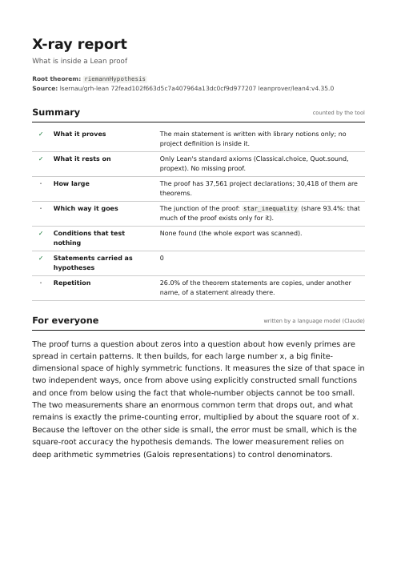

# lean-proof-xray — see inside a Lean proof nobody can read

[Türkçe](README.tr.md)

Machines now write Lean proofs with millions of lines. Lean says "correct". But correct *what*,
resting on *which* assumptions, going through *which* steps? Nobody can open 17 million lines and look.

`lean-proof-xray` looks for you. It reads Lean's own record of the proof and, in minutes to a couple
of hours on a free GitHub runner, hands back a few pages:

- **what was proved**, in plain sentences, and whether the statement hides project-specific definitions
- **which axioms** the proof really uses, and whether a `sorry` is buried in it
- **the skeleton**: the big steps, and how much of the proof sits under each
- **the suspicious spots**: conditions that test nothing, assumptions carried around, duplicate theorems, dead code

The map uses no AI, so nothing in it is guessed: the same input gives the same pages, byte for byte, and anyone
can rerun it and check every number. An optional last step lets a language model turn the map into a
short account of how the proof works; that step is labelled as such, and every structural claim it makes is
checked against the map (see *From the map to a story*).

## What the output looks like

One PDF per proof, in English or Turkish. These are real outputs of the tool, not mock-ups:

| Proof | Output |
|---|---|
| Riemann Hypothesis, 76-thousand-line edition (map + story, 5 pages) | [English PDF](sinama/grh76/RAPOR_en.pdf) · [Türkçe PDF](sinama/grh76/RAPOR_tr.pdf) |
| Riemann Hypothesis, 17-million-line original (map only, 2 pages) | [English PDF](sinama/alpoge/RAPOR_en.pdf) · [Türkçe PDF](sinama/alpoge/RAPOR_tr.pdf) |

[](sinama/grh76/RAPOR_en.pdf)

## X-ray of the 17-million-line proof of the Riemann Hypothesis

In November 2026 Levent Alpöge released a Lean proof of the Riemann Hypothesis: 17 million lines,
written with an AI. Lean accepted it. Below is the same result twice: first in words anyone can
read, then the document the tool itself produced.

### For everyone: what is in it?

*We wrote this part. The number behind every sentence comes from the tool output further down.*

Think of the proof as a 250,000-page book. Nobody can read it cover to cover. An x-ray does not
read the book; it pulls out the table of contents, how much room each chapter takes, and the pages
left blank.

- **What does the book say?** One sentence: the zeros of the zeta function (apart from the known
  simple ones) all sit on the same line. That is exactly the sentence mathematicians have been
  trying to prove for 167 years; nothing else is hidden inside it.
- **How many pieces?** 1,265,256. Of these, 1,075,015 are separately proved intermediate results.
- **Which way does it go?** Almost everything crosses one bridge: an intermediate result the code
  calls "Row". The step "if Row holds, the hypothesis holds" is 79% of the book on its own.
- **How much is repetition?** A quarter. 260,240 intermediate results restate, under a different
  name, a sentence already written elsewhere.
- **Any blanks?** Ten. Picture a form with a box "is this condition met?"; these ten boxes come out
  "yes" whatever you write in them, so they test nothing. Nine have names that already mean
  "unused". The tenth is called `anyGeometry`, and a step carrying 15.6% of the book uses that box
  as a condition.
- **Places that say "let us assume this for now"?** 738. Named intermediate sentences carried from
  step to step as assumptions. 95 of them are labelled "Published" or "Literature" by the code itself.

Days later two shorter editions of the same proof appeared. The same x-ray, run again:

| | ≈17 million lines | ≈300 thousand lines | ≈76 thousand lines |
|---|---:|---:|---:|
| Theorems in the proof | 1,075,015 | 42,204 | 30,418 |
| Boxes that always come out "yes" | 10 | 0 | 0 |
| Intermediate sentences carried as assumptions | 738 | 0 | 0 |
| Axioms outside Lean's standard three | 0 | 0 | 0 |


The cleanup shows up in the numbers. All three editions were measured with the same scan. That is the point of the tool: you do not have to take
anyone's word for what a giant proof contains, or for whether it got cleaner.

None of this says the proof is wrong. Lean accepts the main theorem with no assumptions. The x-ray
shows where to look; mathematicians decide what it means.

### The tool's own output

This is what you get when you give it your own proof. The text below was not written by hand; the
tool produced it, and anyone running it on the same export gets it letter for letter. Names in
square brackets are the names in the code.

<details>
<summary><b>Start of the document: the statement proved and the spine of the proof</b> (click)</summary>

#### 1. The statement proved

The theorem proved by the code is `riemannHypothesis`. Its statement is a single name: `RiemannHypothesis`. Unfolding the library definition of that name gives:

> For every s ∈ ℂ: if ζ(s) = 0 and (there is no n ∈ ℕ such that s = −2 · (↑n + 1)) and s ≠ 1 then Re(s) = 1 / 2.

This sentence is written only with 4,978 concepts of the standard library (Mathlib); it contains no project-specific definition. So understanding what is proved requires reading none of the project's code.

#### 2. The spine of the proof

The whole proof consists of 1,265,256 declarations. The steps below were selected from them by rule: each time, the step with the most proof beneath it was opened. The percentage is the share of the proof that exists only for that step.

| Step | Statement | Share of the proof |
|---:|---|---:|
| 1 | EveryCharacter. | 100.0% |
| 2 | If Row then EveryCharacter. | 79.2% |
| 3 | If OpenLiteratureStatements and VWin then EveryCharacter. | 68.7% |
| 4 | If UnitaryGroupThirdPlaceHypotheses and ThetaLocalInputs and ThetaIntegralsAgree and LocalMatching and CovolumeBoundOfX and RecTExists and VWin then EveryCharacter. | 43.0% |
| 5 | (long; see below) | 37.2% |
| 6 | (long; see below) | 15.6% |
| 7 | If LiteratureRankNHypothesis then VWin. | 8.5% |
| 8 | If HypothesesH' then VWin. | 7.6% |

**Step 1 — 100.0% of the proof** [`UpperTheory.FinalTheorems.everyCharacter`]

Its statement is a single name: **EveryCharacter**. Unfolding the definition:

> For every N ∈ ℕ, χ (a ℂ-valued Dirichlet character modulo N) and s ∈ ℂ (with: N ≠ 0): if 1 / 2 < Re(s) and (χ ≠ 1 or s ≠ 1) then L(χ, s) ≠ 0.

It is reached through these names; at least 97% of the proof of each lies under the next: `riemannHypothesis` → `rhOfAll` → `allChi`.

It rests on:
- 79.2%: [`UpperTheory.FinalTheorems.everyCharacter_of_row`] → Step 2
- 6.4%: [`UpperTheory.Gal.Int.galoisLocalGlobalStrong_recParameter`]
- 14.4%: 58,062 small auxiliary results

**Step 2 — 79.2% of the proof** [`UpperTheory.FinalTheorems.everyCharacter_of_row`]

> If Row then EveryCharacter.

It rests on:
- 68.7%: [`UpperTheory.LiteratureTheorems.every_character_of_literature_of_vWin`] → Step 3
- 8.5%: [`UpperTheory.One.vwin_of_row`] → Step 7
- 2.0%: 7,841 small auxiliary results

*… the document goes on like this for 8 steps.*

</details>

<details>
<summary><b>Table of conditions that test nothing</b> (click)</summary>

#### A. Conditions that are `True` regardless of their arguments (5)

| Name | Arguments | Used by | Heaviest user | Heaviest share |
|---|---:|---:|---|---:|
| `GlobalTheory.Mem.Top.Bl.anyGeometry` | 3 | 9 | `GlobalTheory.Fc.S0.StageU.hypotheses_nonempty_of_unramified_exponents_alt` | 15.6% |
| `GlobalTheory.IndefiniteRowSideFullHecke.UnusedSlot39.trivialClassCondition` | 12 | 2 | `GlobalTheory.HkIntegral.heckeInt` | 0.1% |
| `GlobalTheory.Published.UnusedSlot72` | 0 | 4 | `GlobalTheory.Fc.S0.UnitaryGroupThirdPlaceHypotheses.mk` | — |
| `UpperTheory.GalS.UnusedSlot55` | 6 | 1 | `Formalism.MainNotions.SumRepresentations.CuspidalGaloisUnramified'` | — |
| `Formalism.L2.Pj.trivialClassCondition` | 12 | 0 | — | — |

#### D. Definitions whose body is `True` in the whole export (10; all definitions scanned, library included)

| Name | Arguments |
|---|---:|
| `Formalism.L2.Pj.trivialClassCondition` | 12 |
| `Formalism.L2.PjFree.trivialClassCondition` | 12 |
| `GlobalTheory.BigTop.Fun.trivialTieCondition` | 13 |
| `GlobalTheory.IndefiniteRowSideFullHecke.UnusedSlot39.trivialClassCondition` | 12 |
| `GlobalTheory.Mem.Top.Bl.anyGeometry` | 3 |
| `GlobalTheory.Published.UnusedSlot72` | 0 |
| `UpperTheory.GalS.NoCondition` | 1 |
| `UpperTheory.GalS.UnusedSlot55` | 6 |
| `UpperTheory.One.M.TrivialCondition` | 0 |
| `UpperTheory.V.U3.GCond.noCondition` | 13 |

</details>

The full documents:

| Document | What it shows |
|---|---|
| [`CIKTI_en.md`](sinama/alpoge/CIKTI_en.md) | the statement proved and the spine of the proof, step by step |
| [`KONI.md`](sinama/alpoge/KONI.md) | sizes, duplicates, the dominator tree, the 50 largest steps |
| [`BOS_en.md`](sinama/alpoge/BOS_en.md) | conditions that test nothing |
| [`VARSAYIM_en.md`](sinama/alpoge/VARSAYIM_en.md) | the 80 heaviest of the 738 carried statements and where they are supplied |

The same documents for a small project: [`sinama/pfr/`](sinama/pfr/).

## Try it in four minutes

Fork this repository, open the **Actions** tab of your fork (GitHub asks once to enable workflows),
choose **xray-repo → Run workflow** and press the button with the default values. Four minutes later the x-ray of the PFR project (Tao and collaborators) is in your
fork: three standard axioms, nothing else; no carried assumptions; the spine of the proof with
percentages. Then put your own project in the form.

## From the map to a story

Numbers and names are not an explanation. So there is a third step, and it is the only one that uses a
language model:

1. **Map** (no AI): the tool finds the handful of junction steps of the proof and their weights.
2. **Story** (language model): the model reads the map and then only the code of the junctions it asks
   for, comments stripped, and writes a short account plus a list of checkable claims
   ([the exact instruction](arac/hikaye/ANLATICI.md)).
3. **Check** (no AI): `arac/hikaye/denetle.py` tests every claim against the map and flags heavy steps the
   story left out.

Between 1 and 2 the tool also writes, by fixed rules, the questions the story must answer
(`arac/hikaye/sorular.py`); the checker refuses a story that skips one. Without them a narrator stops at the
skeleton; we saw that happen.

On the 76-thousand-line edition of the Riemann Hypothesis proof this took 16 tool calls and gave an account
that agrees with the author's own guide, which the model never saw. Three independent runs gave the same
skeleton in different words:
[the story](sinama/grh76/HIKAYE.md) · [the report, with what is and is not verified](REPORT.md).
The checker confirms the structure of a story, not its mathematics; that still needs a mathematician.

```bash
python3 arac/hikaye/harita.py  sinama/grh76 --top 20          # where to look
python3 arac/hikaye/kaynak.py  path/to/source star_inequality # the code of one step, comments stripped
python3 arac/hikaye/sorular.py sinama/grh76 path/to/source    # the questions a story must answer
python3 arac/hikaye/denetle.py sinama/grh76 story.md questions.md   # check a story
```

**Using your own Claude for the story step.** The tool contains no AI and asks for no login or key: the
map, the questions, the check and the PDF all run without a model. Only the story is written by a model, and
you bring it yourself: open this repository in Claude Code (or any Claude that can read files and run
commands) and say *"Follow `arac/hikaye/ANLATICI.md` for `sinama/<name>`; the source is in `<folder>`."*
Save what it writes as `sinama/<name>/HIKAYE.md`, run the checker, then the `evrak` workflow to get the PDF.
We tested this step with Claude only.

## Who it is for

- **Mathematicians and referees** facing a machine-written proof: where do I start, what does it rest on?
- **Labs and companies that produce machine proofs:** an independent, reproducible count of what is in the artifact you ship.
- **Lean project maintainers:** does the code match the plan, what is dead, what is duplicated?
- **Anyone curious** who wants a trustworthy short answer to "what does this proof actually prove?"

## What you get

For a root theorem the tool writes, in English and Turkish:

| File | Content |
|---|---|
| `KONI.md` | sizes; every axiom in the proof cone; code in the record the root does not use; duplicate statements; the dominator tree |
| `CIKTI_*.md` | the statement proved, in plain sentences; the spine of the proof with each step's share |
| `VARSAYIM_*.md` | named statements carried as hypotheses, and where in the proof cone each one is built |
| `BOS_*.md` | conditions that are true regardless of their arguments, field-less structures, one-step proofs |
| `MANTIK_*.md` | which theorem delivers which named statement |
| `taslar_ust.tsv`, `aksiyomlar.tsv`, `karsila.tsv` | the tables behind the documents |

A step's "share" is the part of the proof that exists only for that step: its subtree weight in
the dominator tree of the dependency graph.

## Run it on your own project

Free, on GitHub Actions; nothing to install. Fork this repository, then pick one of two ways.

**A. A project that builds on a GitHub runner** (a few thousand to a few hundred thousand lines).
Open **Actions → xray-repo → Run workflow**:

| Input | Example |
|---|---|
| `depo` | `teorth/pfr` (owner/name of the Lean repository) |
| `modul` | `PFR.Main` (module that contains the theorem) |
| `teorem` | `PFR_conjecture` (root theorem) |
| `onek` | `PFR` (the project's module prefixes, space separated) |
| `ad` | `pfr` (folder name for the results) |
| `klasor` | subfolder of the Lake project, if any |
| `kok_onerme` | name of the main statement, if it is a named definition |

The workflow builds the project, takes the export itself and writes the documents. Small projects
take minutes; the build dominates.

**B. A proof too large to build here** (millions of lines). Someone has to produce the export
once with [lean4export](https://github.com/leanprover/lean4export) and put the file at a public
URL (`.ndjson`, `.ndjson.zst` or `.ndjson.gz`). Then open **Actions → xray-export → Run workflow**:

| Input | Example |
|---|---|
| `url` | `https://math.mit.edu/~drew/grh/solution.ndjson.zst` |
| `teorem` | `riemannHypothesis` |
| `mathlib` | the Mathlib commit the proof was built against (optional; gives an exact project/library split) |
| `kokler` | the project's top-level namespaces, space separated; used for the split when `mathlib` is not given |
| `ad` | `alpoge` |

The file is streamed, never stored whole. The 17-million-line proof (a 7.7 GB compressed export,
about a billion expression nodes) takes roughly 75 minutes for the graph on the free runner.

Either way the results are committed to `sinama/<ad>/` in your fork.

The workflow and file names are Turkish: `sinama` = validation, `belgeler` = documents,
`koni` = cone, `agac` = tree, `varsayim` = hypothesis, `bos` = vacuous, `kayit` = export.

From a shell, with a tree folder and a term dump at hand: `arac/hepsi.sh <folder> <dump.jsonl.gz> <main statement or ->`.
For a claim of the form "folder A uses nothing from folder B": `python3 arac/import_tara.py <source root> A B`.

## How it was checked

- **Against brute force.** The dominator tree and subtree sums equal the ones computed straight
  from the definition on 400 random graphs, cycles included (`test/grafik_test.py`, *Actions → test*).
- **End to end on a hand-made export.** A tiny export with a known answer goes through the whole
  pipeline; the axiom list and the "where is it built" classes must match (`test/uctan_uca.sh`).
- **Against hand-written plans.** On three projects with a blueprint the tool had never seen (PFR,
  Carleson, sphere eversion), the heaviest steps overlap with the human plan 49%, 44% and 32% of
  the time; a random pick gives 24.5%, 11.7% and 5.9%. For comparison, ranking by a step's own
  proof size gives 41%, 36% and 23%. Full tables, including the measures that did worse, are in
  [`SINAMA.md`](SINAMA.md).
- **A measure that was tried and dropped.** Path share did better on one project and worse on two;
  it is kept only as an extra file.
- **Against the author's guide.** The guide of the short edition names three main theorems and the
  inequality joining them. The tool, without reading the guide, finds the same names at the top of
  the tree, and adds the percentages the guide does not give.
- **Determinism.** The end-to-end test generates every document twice and compares them byte for byte.

## Limits

It counts; it does not judge:

- It does not decide whether a proof is correct. Lean's kernel and the independent checkers do that; this tool does not replace them.
- It does not explain the mathematics or measure importance. "Weight" is how much proof sits under a step.
- The axiom list and the "where is it built" scan are the newest parts. They are tested end to end on a hand-made export and have run on PFR; treat them as experimental on other projects.

- Lean 4 only.
- Sentences are mechanical renderings and can be long; very long statements are cut and marked as cut.
- "True regardless of arguments" is a syntactic check: it finds bodies that are literally `True`. Zero found is not zero present.
- "Where is it built" works on graph edges: it cannot tell assuming a statement from concluding it.
- Whether a formal statement says what a paper says is still for a human to compare.
- Large proofs need 8–16 GB of memory to turn into documents; the free GitHub runner is enough.

## A second, smaller tool: the passport

`kunye.py` writes a one-page passport for a single theorem: the declarations needed to read its
statement, the axioms, and fingerprints to compare two exports. Example:
[`examples/four-squares.en.md`](examples/four-squares.en.md).

```bash
python3 kunye.py --kayit export.ndjson --teorem Nat.sum_four_squares
```

## Related tools

These solve neighbouring problems. No code was taken from them.

- [lean4checker](https://github.com/leanprover/lean4checker) and independent kernels: actually re-check the proof.
- [lean-tcb](https://github.com/OathTech/lean-tcb): separates the definitions that give a theorem its meaning from proof infrastructure.
- [axiom-audit](https://github.com/leanprover-community/axiom-audit): fails a GitHub check if a declaration depends on an axiom outside an allow-list.
- [gonzalgo](https://pypi.org/project/gonzalgo/): measures where a library uses axioms.
- [LeanParanoia](https://github.com/oOo0oOo/LeanParanoia): tries to catch cheating proofs by dependency analysis and environment replay.
- [leanblueprint](https://github.com/PatrickMassot/leanblueprint): hand-written plans linked to Lean code; used here as the answer key.

Exports are produced with [lean4export](https://github.com/leanprover/lean4export).

## Honesty note

I am not a mathematician. The mathematics and the formalisations belong to their authors: Levent
Alpöge (original proof, [alpo.ge](https://alpo.ge)) and Luke Sernau
([lsernau/grh-lean](https://github.com/lsernau/grh-lean)); the export of the original proof is
hosted by Andrew Sutherland (math.mit.edu/~drew/grh). The tools were written together with Claude.
This repository holds only the tool and its output: counts, trees and reports. Term dumps of the
analysed projects are not stored here.

## License

MIT
