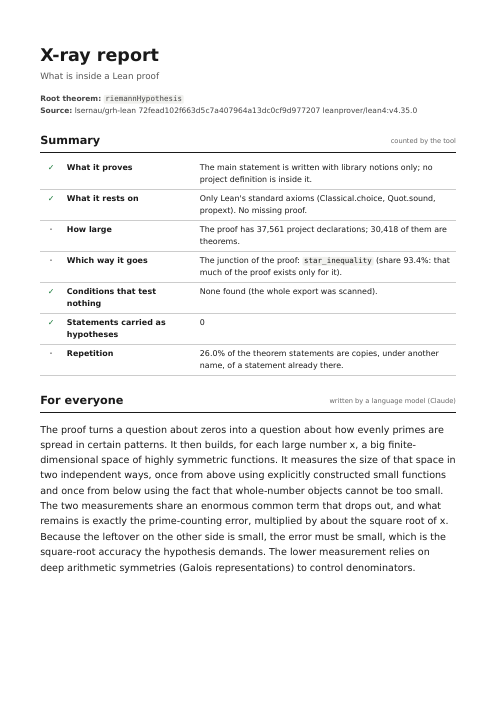

# lean-proof-xray — kimsenin okuyamadığı Lean ispatının içini gör

[English](README.md)

Makineler artık milyonlarca satırlık Lean ispatları yazıyor. Lean "doğru" diyor. Ama *neyi*
kanıtlıyor, *hangi* varsayımlara dayanıyor, *hangi* adımlardan geçiyor? Kimse 17 milyon satırı açıp bakamaz.

`lean-proof-xray` senin yerine bakar. Lean'in ispat için tuttuğu kendi kaydını okur ve ücretsiz bir
GitHub makinesinde, birkaç dakika ile birkaç saat arasında, birkaç sayfa verir:

- **ne kanıtlanmış**, düz cümlelerle; ve cümlenin içinde projeye özgü gizli tanım var mı
- ispat gerçekte **hangi aksiyomları** kullanıyor, içine `sorry` gömülmüş mü
- **iskelet**: büyük adımlar ve her birinin altında ispatın ne kadarı duruyor
- **şüpheli yerler**: hiçbir şey sınamayan koşullar, elden ele taşınan varsayımlar, kopya teoremler, ölü kod

Haritada yapay zekâ yok, yani hiçbir şey tahmin edilmiyor: aynı girdi, harfi harfine aynı sayfaları verir ve
isteyen yeniden koşturup her sayıyı denetleyebilir. İsteğe bağlı son adımda bir dil modeli haritayı ispatın
nasıl işlediğini anlatan kısa bir metne çevirir; o adım açıkça etiketlidir ve modelin her yapısal iddiası
haritaya karşı denetlenir (*Haritadan hikâyeye* bölümüne bakın).

## Çıktı neye benziyor

İspat başına tek bir PDF, Türkçe ya da İngilizce. Bunlar aracın gerçek çıktıları, örnek tasarım değil:

| İspat | Çıktı |
|---|---|
| Riemann Hipotezi, 76 bin satırlık sürüm (harita + hikâye, 5 sayfa) | [Türkçe PDF](sinama/grh76/RAPOR_tr.pdf) · [English PDF](sinama/grh76/RAPOR_en.pdf) |
| Riemann Hipotezi, 17 milyon satırlık özgün sürüm (yalnızca harita, 2 sayfa) | [Türkçe PDF](sinama/alpoge/RAPOR_tr.pdf) · [English PDF](sinama/alpoge/RAPOR_en.pdf) |

[](sinama/grh76/RAPOR_tr.pdf)

## Riemann Hipotezi'nin 17 milyon satırlık ispatının röntgeni

Kasım 2026'da Levent Alpöge, Riemann Hipotezi'nin Lean ispatını yayımladı: 17 milyon satır, yapay
zekâyla yazılmış. Lean kabul etti. Aşağıda aynı sonuç iki biçimde var: önce herkesin okuyabileceği
hali, sonra aracın ürettiği belgenin kendisi.

### Herkes için: içinde ne var?

*Bu bölümü biz yazdık. Her cümlenin arkasındaki sayı, altta duran araç çıktısından alınmıştır.*

Bu ispatı 250 bin sayfalık bir kitap gibi düşün. Kimse baştan sona okuyamaz. Röntgen kitabı okumaz;
içindekiler sayfasını, hangi bölümün ne kadar yer tuttuğunu ve boş kalmış sayfaları çıkarır.

- **Kitap neyi söylüyor?** Tek bir cümleyi: zeta fonksiyonunun sıfırları (bilinen basit olanlar
  dışında) hep aynı çizgide durur. Bu, matematikçilerin 167 yıldır kanıtlamaya çalıştığı cümlenin
  ta kendisi; içine başka bir şey gizlenmemiş.
- **Kaç parçadan oluşuyor?** 1.265.256 parçadan. Bunların 1.075.015'i ayrı ayrı kanıtlanmış ara sonuç.
- **Hangi yoldan gidiyor?** Neredeyse her şey tek bir köprüden geçiyor: kodun "Row" adını verdiği bir
  ara sonuç. "Row doğruysa hipotez doğrudur" adımı tek başına kitabın %79'u.
- **Ne kadarı tekrar?** Dörtte biri. 260.240 ara sonuç, başka bir yerde zaten yazılmış bir cümleyi
  farklı bir adla yeniden söylüyor.
- **Boş kalan yerler var mı?** On tane. Bir formda "şu şart sağlanıyor mu?" kutusu olduğunu düşün;
  bu on kutu, içine ne yazarsan yaz hep "evet" çıkıyor, yani hiçbir şeyi sınamıyor. Dokuzunun adı zaten
  "kullanılmıyor" anlamına geliyor. Onuncusunun adı `anyGeometry`; kitabın %15,6'sını taşıyan bir
  adım bu kutuyu şart olarak kullanıyor.
- **"Şimdilik doğru kabul edelim" denen yerler?** 738 tane. İspat boyunca bir adımdan ötekine
  varsayım olarak taşınan, adı konmuş ara cümleler. 95'inin adında kodun kendi koyduğu "Published"
  ya da "Literature" etiketi var.

Günler sonra aynı ispatın iki kısa sürümü çıktı. Aynı röntgen yeniden çekilince:

| | ≈17 milyon satır | ≈300 bin satır | ≈76 bin satır |
|---|---:|---:|---:|
| İspattaki teorem | 1.075.015 | 42.204 | 30.418 |
| Her zaman "evet" çıkan kutu | 10 | 0 | 0 |
| Varsayım olarak taşınan ara cümle | 738 | 0 | 0 |
| Lean'in standart üçlüsü dışında aksiyom | 0 | 0 | 0 |


Temizlik sayılarda görünüyor. Üç sürüm de aynı taramayla ölçüldü. Aracın anlamı bu: dev bir ispatın içinde ne olduğu ya da temizlenip
temizlenmediği konusunda kimsenin sözüne güvenmek zorunda değilsin.

Bunların hiçbiri ispat yanlış demek değil. Lean ana teoremi hiçbir varsayım olmadan kabul ediyor.
Röntgen nereye bakılacağını gösterir; ne anlama geldiğine matematikçiler karar verir.

### Aracın kendi çıktısı

Kendi ispatını verdiğinde alacağın şey bu. Aşağıdaki metin elle yazılmadı; araç üretti ve aynı
kayıtla çalıştıran herkes harfi harfine aynısını alır. Köşeli parantez içindeki adlar koddaki adlardır.

<details>
<summary><b>Belgenin başı: kanıtlanan cümle ve ispatın omurgası</b> (tıkla)</summary>

#### 1. Kanıtlanan cümle

Kodun kanıtladığı teorem `riemannHypothesis`. Önermesi tek bir addan ibaret: `RiemannHypothesis`. Bu adın kütüphanedeki tanımı açıldığında cümle şudur:

> Her s ∈ ℂ için: eğer ζ(s) = 0 ve (hiçbir n ∈ ℕ için s = −2 · (↑n + 1) doğru olmaz) ve s ≠ 1 ise Re(s) = 1 / 2.

Bu cümle yalnızca standart kütüphanedeki (Mathlib) 4.978 kavramla yazılmıştır; projeye özgü hiçbir tanım içermez. Yani neyin kanıtlandığını anlamak için proje kodunun hiçbir satırını okumak gerekmez.

#### 2. İspatın omurgası

İspatın tamamı 1.265.256 bildirimdir. Aşağıdaki adımlar bunların içinden kurallı olarak seçildi: her seferinde, altında en çok ispat bulunan adım açıldı. Yüzde, ispatın ne kadarının yalnızca o adım için var olduğunu gösterir.

| Adım | Önerme | İspattaki payı |
|---:|---|---:|
| 1 | EveryCharacter. | %100,0 |
| 2 | Eğer Row ise EveryCharacter. | %79,2 |
| 3 | Eğer OpenLiteratureStatements ve VWin ise EveryCharacter. | %68,7 |
| 4 | Eğer UnitaryGroupThirdPlaceHypotheses ve ThetaLocalInputs ve ThetaIntegralsAgree ve LocalMatching ve CovolumeBoundOfX ve RecTExists ve VWin ise EveryCharacter. | %43,0 |
| 5 | (uzun; aşağıda) | %37,2 |
| 6 | (uzun; aşağıda) | %15,6 |
| 7 | Eğer LiteratureRankNHypothesis ise VWin. | %8,5 |
| 8 | Eğer HypothesesH' ise VWin. | %7,6 |

**Adım 1 — ispatın %100,0** [`UpperTheory.FinalTheorems.everyCharacter`]

Önermesi tek bir addan ibaret: **EveryCharacter**. Tanımı açıldığında:

> Her N ∈ ℕ, χ (N modülünde ℂ-değerli bir Dirichlet karakteri) ve s ∈ ℂ (koşullar: N ≠ 0) için: eğer 1 / 2 < Re(s) ve (χ ≠ 1 veya s ≠ 1) ise L(χ, s) ≠ 0.

Buraya şu adlar üzerinden gelinir; her birinin ispatının en az %97'si bir sonrakinin altındadır: `riemannHypothesis` → `rhOfAll` → `allChi`.

Dayandığı parçalar:
- %79,2: [`UpperTheory.FinalTheorems.everyCharacter_of_row`] → Adım 2
- %6,4: [`UpperTheory.Gal.Int.galoisLocalGlobalStrong_recParameter`]
- %14,4: 58.062 küçük yardımcı sonuç

**Adım 2 — ispatın %79,2** [`UpperTheory.FinalTheorems.everyCharacter_of_row`]

> Eğer Row ise EveryCharacter.

Dayandığı parçalar:
- %68,7: [`UpperTheory.LiteratureTheorems.every_character_of_literature_of_vWin`] → Adım 3
- %8,5: [`UpperTheory.One.vwin_of_row`] → Adım 7
- %2,0: 7.841 küçük yardımcı sonuç

*… belge 8 adım boyunca böyle sürer.*

</details>

<details>
<summary><b>Hiçbir şey sınamayan koşullar tablosu</b> (tıkla)</summary>

#### A. Argümanlarına bakmadan `True` olan koşullar (5)

| Ad | Argüman | Kullanan | En ağır kullanan | En ağır pay |
|---|---:|---:|---|---:|
| `GlobalTheory.Mem.Top.Bl.anyGeometry` | 3 | 9 | `GlobalTheory.Fc.S0.StageU.hypotheses_nonempty_of_unramified_exponents_alt` | %15,6 |
| `GlobalTheory.IndefiniteRowSideFullHecke.UnusedSlot39.trivialClassCondition` | 12 | 2 | `GlobalTheory.HkIntegral.heckeInt` | %0,1 |
| `GlobalTheory.Published.UnusedSlot72` | 0 | 4 | `GlobalTheory.Fc.S0.UnitaryGroupThirdPlaceHypotheses.mk` | — |
| `UpperTheory.GalS.UnusedSlot55` | 6 | 1 | `Formalism.MainNotions.SumRepresentations.CuspidalGaloisUnramified'` | — |
| `Formalism.L2.Pj.trivialClassCondition` | 12 | 0 | — | — |

#### D. Bütün kayıtta gövdesi `True` olan tanımlar (10; kayıttaki tanımların tamamı tarandı, kütüphane dahil)

| Ad | Argüman |
|---|---:|
| `Formalism.L2.Pj.trivialClassCondition` | 12 |
| `Formalism.L2.PjFree.trivialClassCondition` | 12 |
| `GlobalTheory.BigTop.Fun.trivialTieCondition` | 13 |
| `GlobalTheory.IndefiniteRowSideFullHecke.UnusedSlot39.trivialClassCondition` | 12 |
| `GlobalTheory.Mem.Top.Bl.anyGeometry` | 3 |
| `GlobalTheory.Published.UnusedSlot72` | 0 |
| `UpperTheory.GalS.NoCondition` | 1 |
| `UpperTheory.GalS.UnusedSlot55` | 6 |
| `UpperTheory.One.M.TrivialCondition` | 0 |
| `UpperTheory.V.U3.GCond.noCondition` | 13 |

</details>

Belgelerin tamamı:

| Belge | Ne gösterir |
|---|---|
| [`CIKTI_tr.md`](sinama/alpoge/CIKTI_tr.md) | kanıtlanan cümle ve ispatın omurgası, adım adım |
| [`KONI.md`](sinama/alpoge/KONI.md) | sayılar, kullanılmayan kod, kopyalar, baskınlık ağacı, en büyük 50 adım |
| [`BOS_tr.md`](sinama/alpoge/BOS_tr.md) | hiçbir şey sınamayan koşullar |
| [`VARSAYIM_tr.md`](sinama/alpoge/VARSAYIM_tr.md) | taşınan 738 önermenin en ağır 80'i ve nerede karşılandıkları |

Küçük bir projede aynı belgeler: [`sinama/pfr/`](sinama/pfr/).

## Dört dakikada dene

Bu depoyu çatalla (fork), çatalının **Actions** sekmesini aç (GitHub iş akışlarını açmak için bir
kez onay ister), **xray-repo → Run workflow** de ve hazır değerlerle düğmeye bas.
Dört dakika sonra PFR projesinin (Tao ve arkadaşları) röntgeni kendi çatalında: üç standart aksiyom,
başka bir şey yok; taşınan varsayım yok; ispatın omurgası yüzdeleriyle. Sonra forma kendi projeni yaz.

## Haritadan hikâyeye

Sayılar ve adlar açıklama değildir. Bu yüzden üçüncü bir adım var, ve dil modeli kullanan tek adım bu:

1. **Harita** (yapay zekâsız): araç ispatın birkaç düğüm noktasını ve ağırlıklarını bulur.
2. **Hikâye** (dil modeli): model haritayı, sonra yalnızca istediği düğüm noktalarının kodunu okur
   (açıklama satırları silinmiş) ve kısa bir anlatım ile denetlenebilir iddialar listesi yazar
   ([verilen talimatın kendisi](arac/hikaye/ANLATICI.md)).
3. **Denetim** (yapay zekâsız): `arac/hikaye/denetle.py` her iddiayı haritaya karşı sınar ve hikâyenin
   atladığı büyük adımları işaretler.

1 ile 2 arasında araç, sabit kurallarla, hikâyenin cevaplamak zorunda olduğu soruları da yazar
(`arac/hikaye/sorular.py`); denetçi bir soruyu atlayan hikâyeyi geçirmez. Sorular olmadan anlatıcı iskelette
kalıyor; bunu deneyde gördük.

Riemann Hipotezi ispatının 76 bin satırlık sürümünde bu 16 işlem sürdü ve yazarın kendi kılavuzuyla
(model onu hiç görmedi) örtüşen bir anlatım verdi. Üç bağımsız yazım, farklı cümlelerle aynı iskeleti verdi:
[hikâye](sinama/grh76/HIKAYE.md) · [rapor: neyin doğrulandığı, neyin doğrulanmadığı](REPORT.md).
Denetçi hikâyenin yapısını doğrular, matematiğini değil; onun için hâlâ bir matematikçi gerekir.

```bash
python3 arac/hikaye/harita.py  sinama/grh76 --top 20          # nereye bakılacak
python3 arac/hikaye/kaynak.py  kaynak/klasoru star_inequality # tek adımın kodu, açıklamasız
python3 arac/hikaye/sorular.py sinama/grh76 kaynak/klasoru    # hikâyenin cevaplaması gereken sorular
python3 arac/hikaye/denetle.py sinama/grh76 hikaye.md sorular.md   # bir hikâyeyi denetle
```

**Hikâye adımında kendi Claude'unu kullanmak.** Aracın içinde yapay zekâ yok; giriş ya da anahtar istemez:
harita, sorular, denetim ve PDF modelsiz çalışır. Yalnızca hikâyeyi bir model yazar ve onu sen getirirsin: bu
depoyu Claude Code'da (ya da dosya okuyup komut çalıştırabilen herhangi bir Claude'da) aç ve şunu söyle:
*"`sinama/<ad>` için `arac/hikaye/ANLATICI.md` dosyasını izle; kaynak `<klasör>` içinde."* Yazdığını
`sinama/<ad>/HIKAYE.md` olarak kaydet, denetleyiciyi çalıştır, sonra PDF için `evrak` iş akışını çalıştır.
Bu adımı yalnızca Claude ile sınadık.

## Kimin işine yarar

- **Makine ispatıyla karşılaşan matematikçiler ve hakemler:** nereden başlayayım, neye dayanıyor?
- **Makine ispatı üreten laboratuvar ve şirketler:** teslim ettiğiniz şeyin içinde ne olduğunun bağımsız, yeniden üretilebilir sayımı.
- **Lean projesi yürütenler:** kod planla örtüşüyor mu, ne ölü, ne kopya?
- **Merak eden herkes:** "bu ispat gerçekte neyi kanıtlıyor" sorusuna güvenilir kısa cevap.

## Ne üretir

Bir kök teorem için, Türkçe ve İngilizce:

| Dosya | İçerik |
|---|---|
| `KONI.md` | boyutlar; ispat konisindeki bütün aksiyomlar; kullanılmayan kod; kopya önermeler; baskınlık ağacı |
| `CIKTI_*.md` | kanıtlanan cümle, düz cümlelerle; ispatın omurgası ve her adımın payı |
| `VARSAYIM_*.md` | varsayım olarak taşınan adlandırılmış önermeler ve her birinin ispat konisinde nerede kurulduğu |
| `BOS_*.md` | argümanlarına bakmadan doğru olan koşullar, alansız yapılar, tek adımlık ispatlar |
| `MANTIK_*.md` | hangi adlandırılmış önermeyi hangi teorem veriyor |
| `taslar_ust.tsv`, `aksiyomlar.tsv`, `karsila.tsv` | belgelerin arkasındaki tablolar |

Bir adımın "payı", ispatın yalnızca o adım için var olan kısmıdır: bağımlılık grafiğinin baskınlık
ağacında o adımın alt ağaç ağırlığı.

## Kendi projende çalıştır

Ücretsiz, GitHub Actions üzerinde; kurulum yok. Bu depoyu çatalla (fork), sonra iki yoldan birini seç.

**A. GitHub makinesinde derlenebilen proje** (birkaç bin satırdan birkaç yüz bin satıra).
**Actions → xray-repo → Run workflow**:

| Girdi | Örnek |
|---|---|
| `depo` | `teorth/pfr` (Lean deposunun sahibi/adı) |
| `modul` | `PFR.Main` (teoremi içeren modül) |
| `teorem` | `PFR_conjecture` (kök teorem) |
| `onek` | `PFR` (projenin modül önekleri, boşlukla) |
| `ad` | `pfr` (sonuç klasörünün adı) |
| `klasor` | Lake projesi alt klasördeyse adı |
| `kok_onerme` | ana önerme adlandırılmış bir tanımsa adı |

İş akışı projeyi derler, kaydı kendisi alır, belgeleri yazar. Küçük projeler dakikalar sürer;
sürenin çoğu derlemedir.

**B. Burada derlenemeyecek kadar büyük ispat** (milyonlarca satır). Birinin kaydı
[lean4export](https://github.com/leanprover/lean4export) ile bir kez üretip herkese açık bir adrese
koyması gerekir (`.ndjson`, `.ndjson.zst` ya da `.ndjson.gz`). Sonra
**Actions → xray-export → Run workflow**:

| Girdi | Örnek |
|---|---|
| `url` | `https://math.mit.edu/~drew/grh/solution.ndjson.zst` |
| `teorem` | `riemannHypothesis` |
| `mathlib` | ispatın kullandığı Mathlib sürümü (isteğe bağlı; proje/kütüphane ayrımını kesin yapar) |
| `kokler` | projenin en üst ad alanları, boşlukla; `mathlib` verilmezse ayrım bunlarla yapılır |
| `ad` | `alpoge` |

Dosya akıtılır, bütünü hiçbir zaman saklanmaz. 17 milyon satırlık ispatın (7,7 GB sıkıştırılmış
kayıt, yaklaşık bir milyar ifade düğümü) grafiği ücretsiz makinede kabaca 75 dakika sürer.

İki yolda da sonuçlar kendi çatalındaki `sinama/<ad>/` klasörüne işlenir.

Elinde ağaç klasörü ve terim dökümü varsa kabuktan: `arac/hepsi.sh <klasör> <döküm.jsonl.gz> <ana önerme ya da ->`.
"A klasörü B klasöründen hiçbir şey kullanmıyor" türü iddialar için: `python3 arac/import_tara.py <kaynak kökü> A B`.

## Nasıl sınandı

- **Kaba kuvvetle.** Baskınlık ağacı ve alt ağaç toplamları, döngülü olanlar dahil 400 rastgele
  grafikte doğrudan tanımdan hesaplananla aynı (`test/grafik_test.py`, *Actions → test*).
- **Elle yazılmış küçük kayıtla, uçtan uca.** Cevabı bilinen küçük bir kayıt bütün hattan geçer;
  aksiyom listesi ve "nerede kuruluyor" sınıfları tutmak zorundadır (`test/uctan_uca.sh`).
- **Elle yazılmış planlarla.** Aracın hiç görmediği, planı (blueprint) olan üç projede (PFR,
  Carleson, küre çevirme) en ağır adımlar insan planıyla %49, %44 ve %32 örtüşüyor; rastgele seçim
  %24,5, %11,7 ve %5,9 verir. Karşılaştırma için: adımın yalnız kendi ispat boyuna göre sıralama
  %41, %36 ve %23 verir. Daha kötü çıkan ölçüler dahil tam tablolar [`SINAMA.md`](SINAMA.md) dosyasında.
- **Denenip bırakılan ölçü.** Yol payı bir projede daha iyi, ikisinde daha kötü çıktı; yalnızca ek
  dosya olarak duruyor.
- **Yazarın kılavuzuyla.** Kısa sürümün kılavuzu üç ana teoremi ve onları birleştiren eşitsizliği
  adıyla sayıyor. Araç, kılavuzu okumadan, aynı adları ağacın tepesinde buluyor ve kılavuzun
  vermediği yüzdeleri ekliyor.
- **Tekrarlanabilirlik.** Uçtan uca test her belgeyi iki kez üretip bayt bayt karşılaştırır.

## Sınırlar

Sayar; hüküm vermez:

- İspatın doğru olup olmadığına karar vermez. Bunu Lean çekirdeği ve bağımsız denetleyiciler yapar; bu araç onların yerine geçmez.
- Matematiği açıklamaz, önem ölçmez. "Ağırlık", bir adımın altında ne kadar ispat durduğudur.
- Aksiyom listesi ve "nerede kuruluyor" taraması en yeni parçalardır. Elle yazılmış bir kayıtla uçtan uca sınandı ve PFR'de koştu; başka projelerde deneysel sayın.

- Yalnızca Lean 4.
- Cümleler mekanik çeviridir, uzun olabilir; çok uzun önermeler kesilir ve kesildiği yazılır.
- "Argümanlarına bakmadan doğru" taraması biçime bakar: gövdesi harfi harfine `True` olanları bulur. Sıfır bulunması, hiç olmadığı anlamına gelmez.
- "Nerede kuruluyor" taraması grafik kenarlarıyla çalışır: bir önermeyi varsaymakla sonuç olarak vermeyi ayıramaz.
- Biçimsel bir önermenin bir makaledeki cümleyle aynı şeyi söyleyip söylemediğine hâlâ insan bakar.
- Büyük ispatlarda belge üretimi 8–16 GB bellek ister; ücretsiz GitHub makinesi yeter.

## İkinci, küçük araç: künye

`kunye.py` tek bir teorem için tek sayfalık künye yazar: önermesini okumak için gereken
bildirimler, aksiyomlar ve iki kaydı karşılaştırmak için parmak izleri. Örnek:
[`examples/dort-kare-teoremi.tr.md`](examples/dort-kare-teoremi.tr.md).

```bash
python3 kunye.py --kayit kayit.ndjson --teorem Nat.sum_four_squares --dil tr
```

## İlgili araçlar

Komşu sorunları çözen araçlar. Onlardan kod alınmadı.

- [lean4checker](https://github.com/leanprover/lean4checker) ve bağımsız çekirdekler: ispatı gerçekten yeniden denetler.
- [lean-tcb](https://github.com/OathTech/lean-tcb): bir teoreme anlamını veren tanımları ispat altyapısından ayırır.
- [axiom-audit](https://github.com/leanprover-community/axiom-audit): izin listesi dışındaki bir aksiyoma dayanan bildirim varsa GitHub kontrolünü durdurur.
- [gonzalgo](https://pypi.org/project/gonzalgo/): bir kütüphanenin aksiyomları nerede kullandığını ölçer.
- [LeanParanoia](https://github.com/oOo0oOo/LeanParanoia): bağımlılık analizi ve ortamı yeniden oynatarak hileli ispatları yakalamaya çalışır.
- [leanblueprint](https://github.com/PatrickMassot/leanblueprint): Lean koduna bağlı, elle yazılmış planlar; burada cevap anahtarı olarak kullanıldı.

Kayıtlar [lean4export](https://github.com/leanprover/lean4export) ile üretilir.

## Dürüstlük notu

Matematikçi değilim. Matematik ve biçimlendirmeler yazarlarına aittir: Levent Alpöge (özgün ispat,
[alpo.ge](https://alpo.ge)) ve Luke Sernau ([lsernau/grh-lean](https://github.com/lsernau/grh-lean));
özgün ispatın kaydını Andrew Sutherland barındırıyor (math.mit.edu/~drew/grh). Araçlar Claude ile
birlikte yazıldı. Bu depoda yalnızca araç ve çıktısı durur: sayılar, ağaçlar, raporlar. İncelenen
projelerin terim dökümleri burada saklanmaz.

## Lisans

MIT
